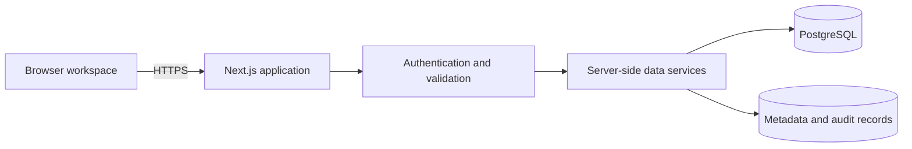

# NS Labs ERP

NS Labs ERP is a web application that supports day-to-day record management for NS Labs' 3D-printing business. It brings workshop, materials, sales, and payment records into a single authenticated workspace.

This README describes the application's purpose and software design. Company financial figures, customer information, supplier terms, product economics, internal reporting rules, and production access details are outside the scope of public documentation.

## Business purpose

The application helps authorized staff maintain consistent operational records, reduce repeated data entry, and review activity across the business. Its main areas cover:

| Area | General purpose |
| --- | --- |
| Workshop | Organize operating and equipment-related records |
| Materials | Maintain material purchase records |
| Sales log | Record product sales and their sales channels |
| Payments | Track marketplace payment records and confirmation status |
| Dashboard | Summarize recorded activity for internal review |
| Custom pages | Add structured records for other operational needs |

These are general product capabilities, not disclosures of NS Labs' transaction volumes, financial performance, commercial arrangements, or business strategy. The application supports operational review; it is not a complete accounting or manufacturing system.

## Features

- Search, column filters, date sorting, pagination, and alternating row shading.
- Inline editing with **Enter** to save and **Escape** to cancel.
- Read-only calculated fields to preserve database-generated results.
- New entries and additional text, number, date, or checkbox columns.
- Configurable dropdown choices and expandable category summaries.
- Custom pages grouped in the sidebar, with their own editable records.
- Monetary entry and display in supported currencies, with server-side conversion to a base currency.
- Dashboard summaries for authorized users.
- A read-only Shopee orders page showing the latest collected To Ship report, order items, buyer payment totals, and collection freshness. This does not create sales-ledger entries.

Display currency changes do not rewrite saved records. Currency conversion assumptions and internal reporting conventions should be reviewed by authorized operators before interpreting financial information. Dashboard summaries are operational indicators rather than audited financial statements.

## How it works



The React interface communicates with server-side Next.js route handlers. Those handlers check access, validate input, and use a pooled PostgreSQL connection to read or update records. Database connection credentials stay on the server.

PostgreSQL is the primary persistence backend. An optional Google Sheets adapter provides an alternative backend; automatic synchronization between the two is not implemented. Demo records are fictional and temporary.

### Technology

| Layer | Implementation |
| --- | --- |
| Application | Next.js App Router and React |
| Interface | Custom CSS and Lucide icons |
| Data access | Node.js and `pg` |
| Persistence | PostgreSQL with application metadata and audit records |
| Packaging | Multi-stage Docker build and standalone Next.js server |
| Validation | Node.js tests and optional PostgreSQL integration tests |

See [package.json](package.json) and [package-lock.json](package-lock.json) for dependencies. The Docker image uses Node.js 22; local development requires Node.js 20.9 or later.

### Code layout

```text
app/                      Pages, styles, and API route handlers
components/               Workspace, tables, forms, and dashboard
lib/                      Authentication, validation, and backend services
sql/                      Ordered database permission and feature migrations
scripts/                  Provisioning and maintenance utilities
deployment/               Deployment tooling
tests/                    Unit and optional database integration tests
```

Business tables hold operational records. Separate application metadata describes custom pages, additional columns, and selection choices. Custom page and column creation uses validated database functions rather than accepting arbitrary SQL from the browser.

### Data integrity and access

The application uses authenticated sessions, server-side validation, origin checks for writes, and restricted runtime database permissions. Updates use transactional auditing and stale-record detection. Operation identifiers allow supported writes to be retried without applying the same operation twice.

Production credentials, sessions, database exports, and audit logs must remain in authorized systems. Audit logs can contain sensitive business values and require the same access and backup controls as the primary database. This public overview is not a production security assessment.

## Development

```sh
npm ci
npm run dev
```

Configure an untracked `.env.local` before connecting a backend. The following values are illustrative placeholders, not NS Labs production settings:

```dotenv
DATA_BACKEND=postgres
DATABASE_URL=postgresql://APP_USER:APP_PASSWORD@DB_HOST:5432/APP_DATABASE
POSTGRES_LOGIN_USER=AUTHORIZED_LOGIN_USER
APP_URL=http://localhost:3000
SESSION_SECRET=REPLACE_WITH_A_RANDOM_SECRET_OF_AT_LEAST_32_CHARACTERS
```

Generate a session secret with:

```sh
node -e "console.log(require('crypto').randomBytes(32).toString('hex'))"
```

See [.env.example](.env.example) for configuration variables. Use a separately provisioned development database. Provisioning scripts and migrations include installation-specific assumptions that must be reviewed before reuse; this repository is not a one-command empty-database installer.

### Checks

```sh
npm test
npm run build
```

The tests cover typed field validation, calculated-field protection, filtering and sorting, selection management, page creation, audited record management, and currency conversion. Optional integration tests require `TEST_DATABASE_URL` targeting the disposable test database expected by the test suite. Never run them against production or use real customer records as fixtures.

## Deployment overview

The application can run as a Docker container using Docker Compose. The image runs tests and builds the application before producing the standalone runtime. Deployment requires an independently configured database, server-side environment variables, HTTPS routing, and appropriate network access controls.

Repository deployment files are examples of the existing installation and require review before reuse. Environment files, database backups, and access keys must remain outside source control and container images. Apply database migrations separately through an authorized administrative workflow after taking a backup.

The optional repository watcher can detect new revisions, build and deploy an image, verify health, and attempt rollback if a replacement fails. Database migrations and infrastructure configuration are managed separately from application releases. Deployment access and operational runbooks belong in restricted administrator documentation.

## Scope and documentation privacy

The application does not currently provide automatic marketplace order imports, PostgreSQL-to-Sheets synchronization, material-consumption tracking, or a full accounting workflow.

Contributions, screenshots, examples, issues, and logs should use synthetic or redacted data. Do not publish:

- Revenue, costs, margins, actual transaction amounts, or internal financial calculations.
- Customer or buyer identities, order references, contact details, or payment information.
- Supplier pricing, purchasing terms, product costing, or non-public commercial plans.
- Production URLs, network addresses, database identifiers, account names, secrets, access keys, or backup locations.
- Database exports, real audit records, or screenshots of live business records.

Keep company-specific operating procedures and production setup details in access-controlled documentation. General software capabilities and architecture can be documented here without exposing business records.
